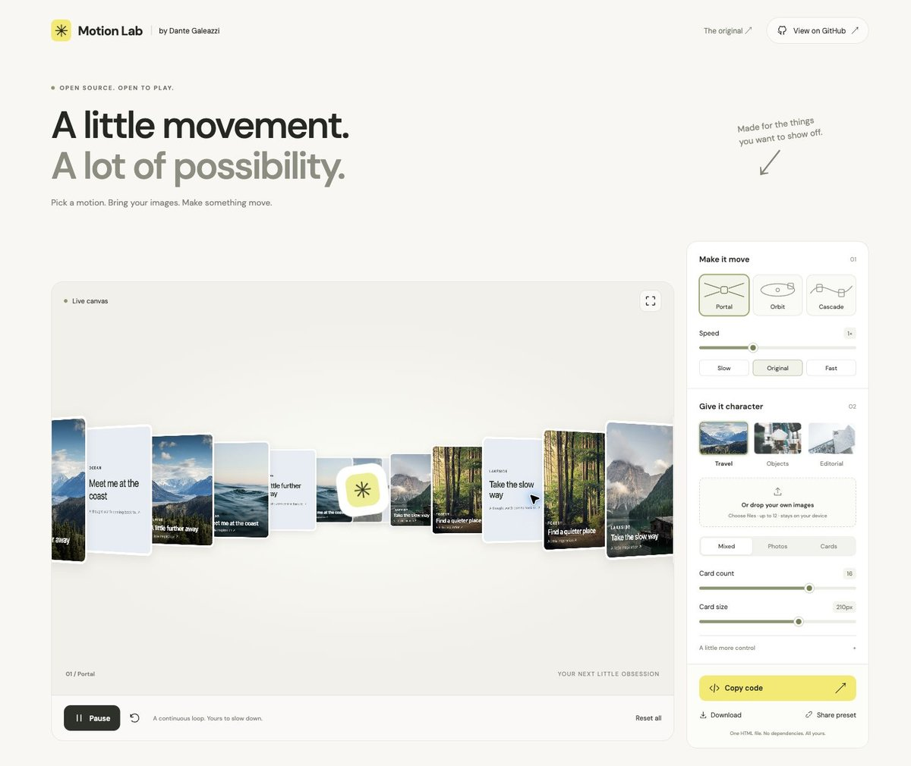
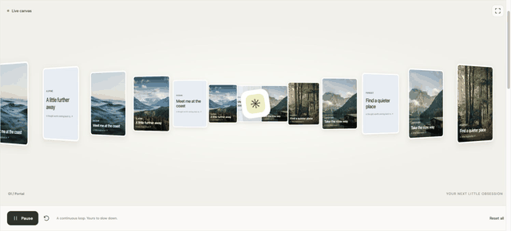
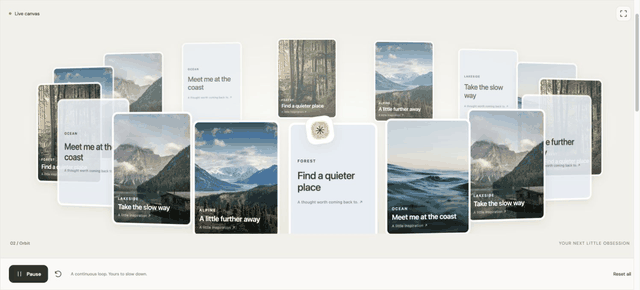
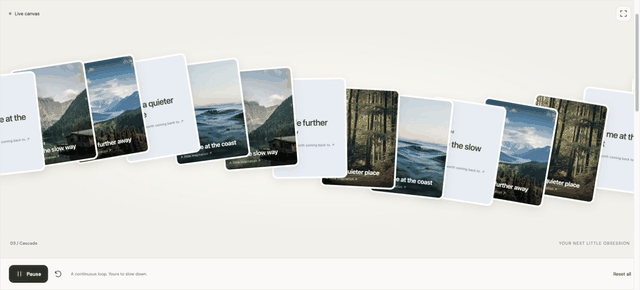
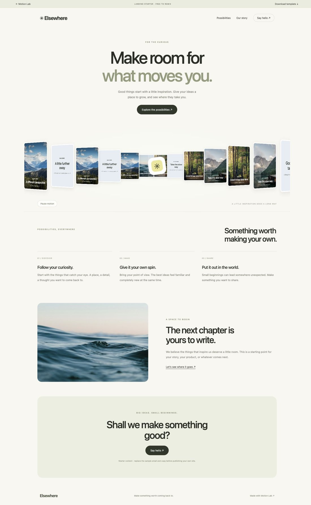
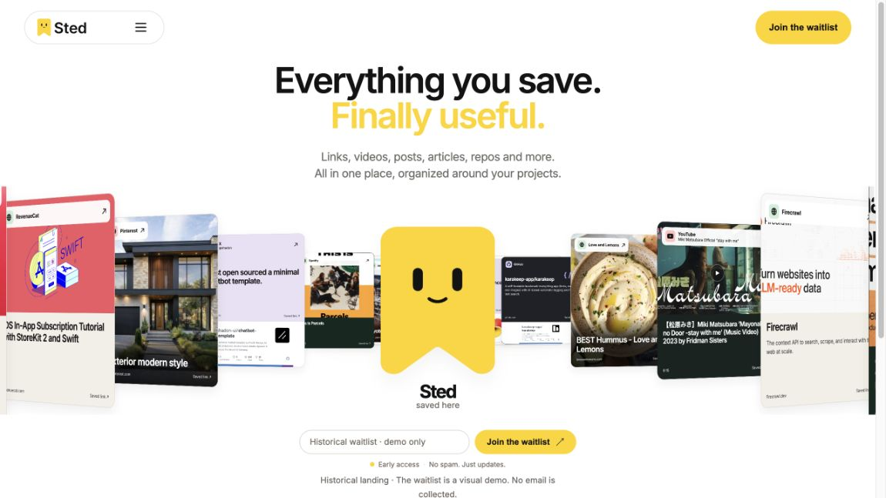

<div align="center">

# Motion Lab

**Beautiful image animations. Tweak them. Take the code.**

An open-source playground by [Dante Galeazzi](https://github.com/dantegaleazzi).

[**Try the playground ↗**](https://dantegaleazzi.github.io/motion-lab/) · [**Get the landing starter**](templates/landing/) · [**Download v0.3.0**](https://github.com/dantegaleazzi/motion-lab/releases/tag/v0.3.0)

[](LICENSE)
[](https://github.com/dantegaleazzi/motion-lab/releases)
[](https://github.com/dantegaleazzi/motion-lab/actions/workflows/checks.yml)


[](https://dantegaleazzi.github.io/motion-lab/)

**Your images. Your rhythm. Your next website.**

</div>

## Three ways to move

|                                                Portal                                                 |                                               Orbit                                                |                                                 Cascade                                                  |
| :---------------------------------------------------------------------------------------------------: | :------------------------------------------------------------------------------------------------: | :------------------------------------------------------------------------------------------------------: |
| [](https://dantegaleazzi.github.io/motion-lab/#mode=portal) | [](https://dantegaleazzi.github.io/motion-lab/#mode=orbit) | [](https://dantegaleazzi.github.io/motion-lab/#mode=cascade) |
|                                   Bring everything into one place.                                    |                                  Give your images room to orbit.                                   |                                        Let the inspiration flow.                                         |

_Real recordings from the playground. Prefer less motion? Open the [static preview](docs/media/playground.jpg)._

## Make something yours in a minute

1. **Pick a motion.** Portal, Orbit or Cascade. Start with Travel, Objects or Editorial photos.
2. **Bring your images.** Drop files or choose them from your device. They stay in your browser.
3. **Find your rhythm.** Change speed, count, size, depth, tilt and direction. Start with 16 cards at 210px.
4. **Take it with you.** Copy or download one HTML file, with the images embedded. Open that exported file directly in a modern browser.

Make a hero for your portfolio, a product showcase, an editorial collection, or a landing page with a little more life. No sign-up. No runtime packages. No build step.

## Want a whole website? Start here.

[](https://dantegaleazzi.github.io/motion-lab/templates/landing/)

A responsive landing page with the animation already wired up: hero, benefits, story and a final CTA. Change the copy, colors, images and motion in **one config file**, then make it your own.

[**Preview the starter ↗**](https://dantegaleazzi.github.io/motion-lab/templates/landing/) · [**Download template ZIP**](https://github.com/dantegaleazzi/motion-lab/releases/download/v0.3.0/motion-lab-landing-v0.3.0.zip) · [**Customization guide**](templates/landing/README.md)

## Run the playground locally

Download the [source ZIP](https://github.com/dantegaleazzi/motion-lab/archive/refs/tags/v0.3.0.zip), or clone it:

```sh
git clone https://github.com/dantegaleazzi/motion-lab.git
cd motion-lab
python3 -m http.server 5186 --bind 127.0.0.1
```

Open **http://127.0.0.1:5186/**. No install is needed to use the playground. A static server is required because it uses JavaScript modules and loads export assets. The generated standalone HTML files work directly from disk.

## Use the engine directly

Copy `motion.js` and `scene.css` into your project, include the CSS and give the scene a height:

```html
<link rel="stylesheet" href="./scene.css" />
<div id="my-motion" style="height: 480px"></div>
<script type="module">
  import { MotionScene } from "./motion.js";

  const scene = new MotionScene(
    document.querySelector("#my-motion"),
    [
      {
        src: "./my-photo.jpg",
        title: "A little inspiration",
        category: "Explore",
      },
    ],
    { mode: "portal", speed: 1, count: 16, size: 210 },
  );

  // scene.setPlaying(false);
  // scene.update({ mode: 'orbit', speed: 0.5 });
  // scene.destroy(); // when removing the scene from your application
</script>
```

Pass at least one image item. `update()` uses defaults for omitted options; pass your full configuration to preserve customized values. The engine supports pause, restart, resize, visibility handling and cleanup. Keep the MIT notice with copies of the code.

## Controls & practical details

| Control         | Range / behavior                                             |
| --------------- | ------------------------------------------------------------ |
| Motion          | Portal, Orbit, Cascade                                       |
| Speed           | 0.25×–2.5×, with Slow / Original / Fast presets              |
| Card count      | 6–20; default 16                                             |
| Card size       | 120–260px; default 210px, responsive to the canvas           |
| Card appearance | Photos, text cards, or mixed                                 |
| Advanced        | Depth, tilt, reverse direction, center mark                  |
| Playback        | Play/pause, restart, fullscreen, reset                       |
| Your images     | Up to 12 JPG, PNG, WebP, AVIF or GIF files, under 10 MB each |
| Exports         | Standalone HTML with images and license notices included     |
| Sharing         | A URL with your configuration and a sample collection        |

Images are resized in the browser to a maximum dimension of 1000px. Animated inputs become a still frame. Local images disappear on refresh and are **not** included in shared preset links; they **are** included in exported HTML. The interface loads DM Sans from Google Fonts with a system-font fallback; exports use system fonts and do not need network requests to animate.

This release does not export video/GIF and is not an npm package or a ready-made React component. See [release notes](CHANGELOG.md) and [browser QA](docs/BROWSER_QA.md) for the exact scope and verification limits.

## Originally built for Sted

[](https://dantegaleazzi.github.io/motion-lab/examples/sted/)

I built the original portal animation for Sted, then opened it up as Motion Lab. The historical landing is preserved as a case, with a button to load its cards and motion into the playground. Sted is an example; Motion Lab is an independent project.

[**Explore the original ↗**](https://dantegaleazzi.github.io/motion-lab/examples/sted/)

## Contribute a little movement

Ideas, browser fixes, useful presets and thoughtful new motions are welcome. [Read the contribution guide](CONTRIBUTING.md), [report a bug](https://github.com/dantegaleazzi/motion-lab/issues) or open a focused pull request with a screenshot or recording.

With Node.js 22 or newer, run `npm test` — no package install is required. Checks run automatically on pushes and pull requests. Motion geometry lives in `motion.js`, the shared styles in `scene.css`, and exports reuse the same engine. [Possible next experiments](IDEAS.md).

## License & credits

**Code: [MIT](LICENSE). Assets: [separate notices](ASSET_LICENSES.md).** Sample photos use the Unsplash License. Sted brand artwork and third-party content previews belong to their respective owners and are included for the historical case. Use your own branding and images for your projects, or comply with the applicable asset license. Exported HTML carries the code and asset notices; the visible attribution link is optional under MIT.

Built by [**Dante Galeazzi**](https://github.com/dantegaleazzi). If you make something with it, [share it in an issue](https://github.com/dantegaleazzi/motion-lab/issues) — I'd love to see it.
